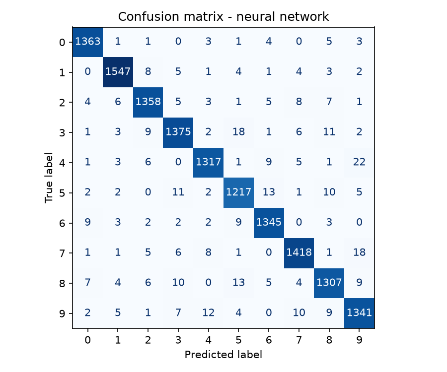
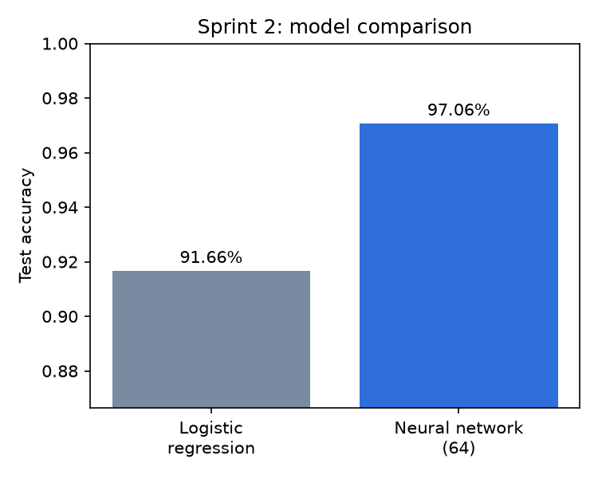
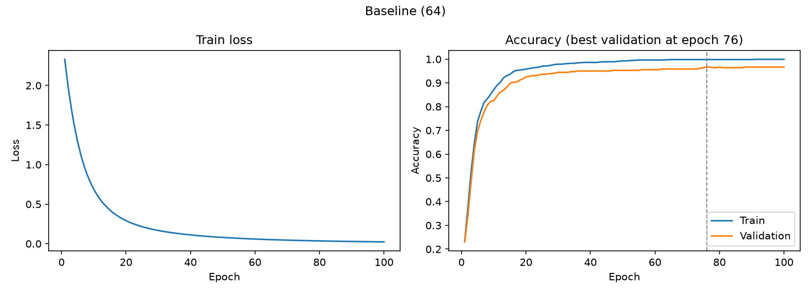
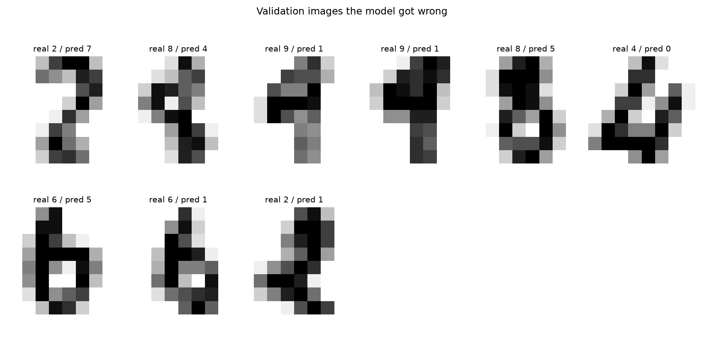

# Handwritten Digit Classifier

A neural network in Python that recognizes handwritten digits (0-9),
reaching **97.06% test accuracy on MNIST**, compared with a
logistic regression baseline.



## Problem
Given a grayscale image of a handwritten digit, predict which digit
(0-9) it shows. I used two datasets:
- **MNIST**: 70,000 images of 28x28 pixels (80% train / 20% test).
- **scikit-learn `load_digits`**: 1,797 images of 8x8 pixels, used for
  fast experimentation.

## Approach
1. **Baseline:** logistic regression (scikit-learn), which is a neural
   network with no hidden layer.
2. **Neural network:** one hidden layer with ReLU activation.
3. **Experiments:** 10 variations on `load_digits`, changing one
   thing at a time (learning rate, hidden size, depth, regularization).

## Results

| Dataset     | Model               | Test accuracy |
|-------------|---------------------|---------------|
| MNIST       | Logistic regression | 91.66%        |
| MNIST       | Neural network      | **97.06%**    |
| load_digits | Logistic regression | 97.22%        |
| load_digits | Neural network      | 98.06%        |



On MNIST, the hidden layer and non-linearity give a clear gain (+5.4
points). On the small `load_digits` set the two models are nearly tied,
since a linear model already handles the simpler 8x8 images.

### Tuning experiments (`load_digits`)
Full table in [results/experiments.md](results/experiments.md). The best
configuration used 256 hidden neurons (98.43% validation, 97.78% test,
352/360 correct). A lower learning rate hurt (~95%), and a second hidden
layer did not help. Differences under ~1 point are within noise with a
360-image test set.



Loss drops quickly and then flattens; training and validation accuracy
stay close, with slight overfitting.

### Error analysis
On `load_digits`, the baseline model made 9 mistakes out of 360 test
images. The most frequent confusion was true 9s predicted as 1 (twice);
the other errors were single cases such as 6→5, 8→4 and 2→7. With only
8x8 pixels, thin or slanted digits lose a lot of detail, which likely
makes these shapes look alike.



## How to run
```bash
git clone https://github.com/sofiappdcr/<digit-classifier>.git
cd <repo-name>
python -m venv venv
source venv/bin/activate        # Windows: venv\Scripts\activate
pip install -r requirements.txt
python sprint2.py               # compares models on both datasets
python sprint3.py               # training curve, confusion matrix, experiments
```
Tested with Python 3.14.8.

## What I learned
- Logistic regression is a neural network without hidden layers; the
  hidden layer plus ReLU is what lets the network learn patterns a
  linear model cannot.
- Reading train vs. validation curves: close and high means it
  generalizes; train high and validation low means overfitting.
- Loss measures how wrong *and how unsure* the model is, while accuracy
  only counts right or wrong.
- With small test sets, differences of a few images are noise.

## Project structure
- `load_data.py`: loads and explores the data
- `sprint2.py`: model comparison
- `sprint3.py`: training curve, confusion matrix, experiments
- `results/`: plots and experiment log
- `NOTES.md`: full development log